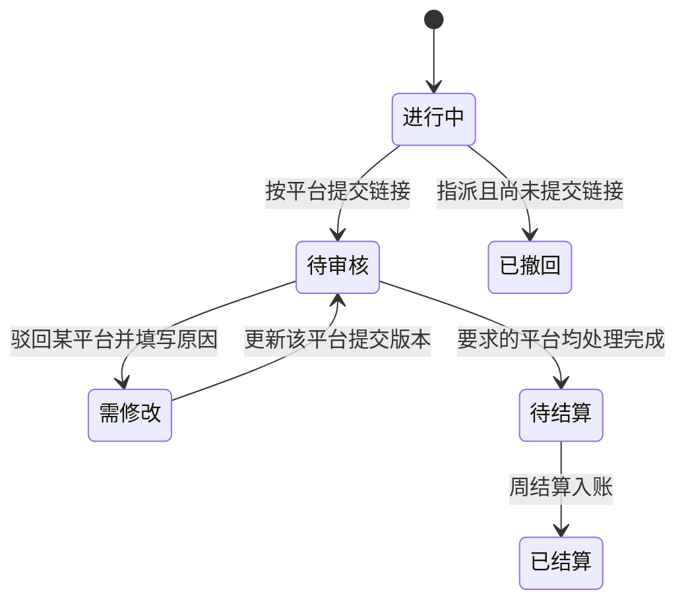
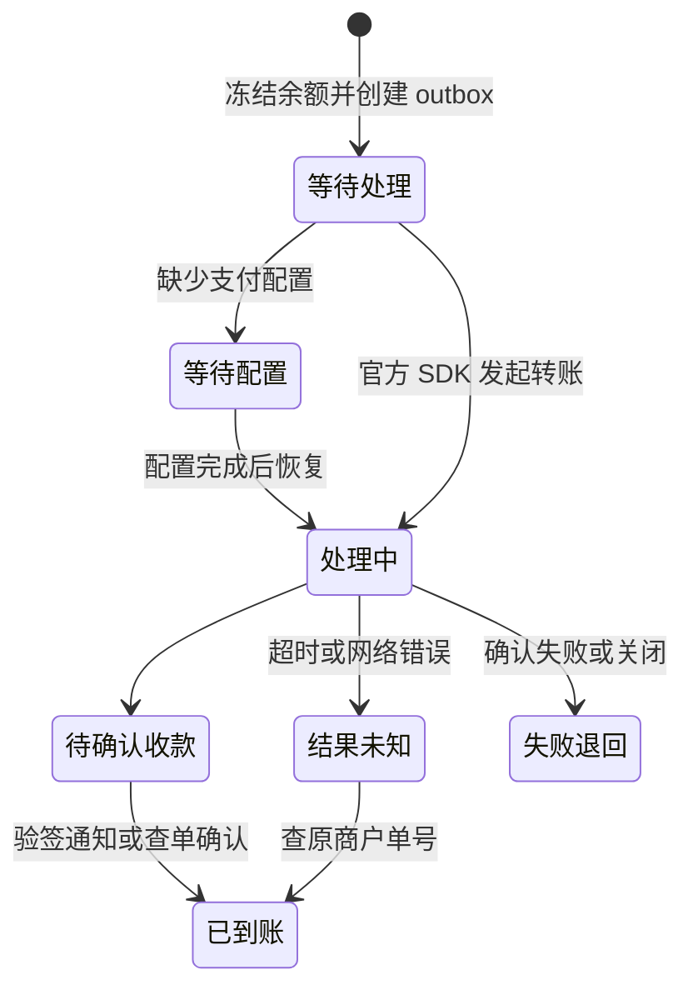

# 第一阶段业务规则

## 范围与资料

首次微信注册从 `nickname` 计数器取号，保存「微信用户」加最短 4 位的 Sqids 后缀。已被用户占用的昵称会跳过。再次登录沿用已保存的昵称，营销任务从独立的 `task` 计数器取号。

仅营销分发及登录、报名、协议、文件、余额、站内通知、反馈和审计。AI 选品、达人切片、素材拍摄、新手起号、点数体系不建立后端模型。

微信 `code2session` 在服务端兑换身份；客户端仅保存本系统会话，不获得微信 Secret、session_key 或商户私钥。报名收集姓名、身份证、手机号及平台账号，敏感信息 AES-GCM 加密，查询脱敏。当前报名人工审核和格式检查不等同于权威实名核验，接入权威核验服务尚待确定。

报名通过、账号未禁用并确认当前协议后才能领取或被指派。协议确认携带阅读过的协议 ID；版本更新时拒绝旧版确认，要求重新阅读。任务已领取后的结算使用历史快照，不因后来改价而重算。

## 领取、指派与版本

- 常规分发和创作任务共用唯一序号，展示为 `RW-` 加 Sqids 编码。后缀区分大小写，从 4 位起随序号增长。改版、领取和重派均沿用该任务的编号。
- 取号用一条独立提交的 upsert 原子递增并返回新序号。创建任务失败允许跳号，已取出的序号不回收。
- 运营新建营销任务后直接进入内容池，素材和任务首版同一事务保存。已上架且未截止的内容可以领取或指派。
- 一条常规内容只能被一名分发员领取或指派。自领与指派共用按北京时间计算的每日常规名额（默认 1 条，运营可调，降低上限保留已领任务）。数据库唯一键与事务共同限制。
- 分发员从单一入口请求领取。后端优先选择相同标签数最多的可分配内容，同分时选较新的当前版本；没有匹配时按队列顺序取最早发布的当前版本。匹配在领取请求中执行。
- 任务每次发布新版本保存创建人、正文、文件、标签、平台和每平台价格，历史版本不可修改。
- 指派占用当日名额；仅工作人员指派且未提交任何平台链接的任务可以撤回。撤回释放内容及当日名额。
- 重派仅针对选中的平台，保存派发时的最新版本和价格，关联原任务。当天尚无常规名额时重派占用该名额；已有名额时仍允许补发。
- 已失效的原平台记录禁止再提交、审核或结算。标记“照常结算”保留原奖励；已结算记录不能再重派改账，必须关联原流水调整。

业务日期为北京时间。新领取、手动指派和重派在分配时保存首次提交截止时间。固定时长为分配后 0.5～24 小时，以半小时为单位，默认 1 小时。当天截止为分配当天 24:00，即北京时间次日 00:00。修改设置后，新分配使用新规则；已分配任务按保存的截止时间执行。到期无发布链接的任务自动失效，常规内容重新可分配，原分发员仍占用已用名额。已有链接和被驳回重交的记录继续按原审核流程处理。存量无具体截止时间的记录仍采用原业务日期。

营销总单价调整后，后续领取、指派和重派以新单价生成价格快照。营销分发整体下架暂停新领和手动指派，已分配内容仍可提交。

## 平台审核与五步进度

每个平台独立审核；审核必须携带提交修订号，拒绝对后台未看过的新链接执行旧版审核。平台记录可分别入账。任务汇总状态优先显示需修改、待审核；仍缺平台时保持进行中；失效平台不阻止其余有效平台结算。

五步独立回显：获取内容要求、完成发布、提交链接、提交播放数据截图、完成结算。前两步由用户确认，后三步由实际提交和入账计算，不能用单一任务状态覆盖全部进度。

链接仅接受指定平台的 HTTPS 作品链接。同一作品链接允许用于不同任务，每个任务按平台独立保存一条提交记录。后端校验链接域名和路径，无需访问链接或解析短链。

## 周结算与余额

业务事务不使用按字符串 key 申请的咨询锁。已有记录使用 `SELECT FOR UPDATE`；领取和重派按用户、任务、派发记录的顺序加锁，结算按派发 ID 排序锁定整批记录，再按钱包 ID 排序锁定钱包。钱包检查与金额计算均在获得行锁后执行。首次登录、结算批次使用唯一约束及 `ON CONFLICT DO NOTHING` 处理并发创建，重复请求返回已有结果。

首次协议发布可能没有可锁行，因此发布事务使用协议表的短期 `SHARE ROW EXCLUSIVE` 表锁；协议确认锁定用户及当前协议。普通用户申请上传锁定用户行；配置管理员没有用户行，其上传凭证申请使用文件表的同类短期表锁。外部文件请求和微信调用不在这些事务内执行。独立迁移命令的 schema 迁移互斥锁保留，不参与业务事务。

审核通过后进入待结算。到达配置的开放时间后，运营在「分发结算」核对平台明细并确认入账。同一事务生成批次、明细和账本并增加可提现余额。

在「营销分发 → 分发设置」配置首次链接时限、截图截止和顺延期数，以及结算频率与开放时间。以北京时间计算。每天结算前一天任务，每周结算上一个自然周，每月结算上一个自然月并支持指定 1 至 31 日，遇短月用最后一天。按时长结算从领取、指派或重派时起算。默认周一 00:00 开放入账，截图周一 12:00 截止，逾期补交顺延一期。

日历结算以原定结算日的配置时刻作为截图截止点。逾期从补交时已经到达的最近一个结算日顺延指定期数。按时长结算的截图截止从分配起算，逾期从补交时起按配置的结算等待时长与顺延期数计算。已有任务的首次链接截止时间与已交截图记录的结算时间保留。后续截图提交使用保存后的规则。

结算仅包含审核通过或照常结算、截图齐全、可见性人工确认或平台确认、到期且尚未入账的平台记录。锁定记录后再次检查这些条件和核对版本。单批上限 1000 条，超限拒绝整批。

金额单位统一为分：PostgreSQL `NUMERIC(24,0)`，Go `decimal.Decimal`，接口字符串。页面展示元并保留两位小数。输入不足一分直接拒绝；将来产生比例计算时只在记账边界四舍五入至整数分，不逐步舍入。微信官方 API 要求整数 JSON 分值时在 SDK 边界精确转为 `int64`，不经过浮点。

账本金额是“可用余额变动”：提现冻结为负值，到账确认可用余额变化为 0，失败退回为正值。可用、冻结、累计到账分开存储，禁止混作一项。账本、任务版本、结算批次明细、协议同意记录、审计由数据库禁止更新/删除；账本纠错生成关联原账的调整流水，保留原因与操作人。

## 异步提现

提现从用户可提现余额中扣减指定金额并冻结，不关联任务。当前本地单笔范围 0.10～200.00 元；正式范围应与商户能力和运营规则共同确定。

商户单号固定为提现 KSUID。超时先查原单；只有官方明确 `NOT_FOUND` 且创建未超过 24 小时才允许用原单号补发，绝不自动换单号。未知结果保留冻结，不依据超时自动退钱。

通知与查单核对商户、AppID（响应有该字段时）、金额、收款身份、商户单号及微信单号。终态不可逆，重复通知不重复记账；worker 的旧响应不能覆盖通知写入的终态。小程序确认收款的回调仅刷新服务端结果，不作为到账凭据。

## 1126 创作分发

创作领取和常规分发分别计数。创作入口关闭或单任务下架只停止新领取。分发员按要求提交作品与发布文案，运营按修订号通过或说明原因驳回。通过后提交各平台发布链接。创作费和每平台发布费作为任务价格快照。交齐链接后计入下一周一待结算。

达到兑奖时间且发布满指定天数后，分发员按平台上传点赞截图；运营核实对应截图并录入点赞数。截图有更换时，须重新核对。系统按任务的分平台或合计规则计算最高已达档奖励，确认后归入下一周一。核定和确认入账分别留痕，已核定结果不可重复发奖。
