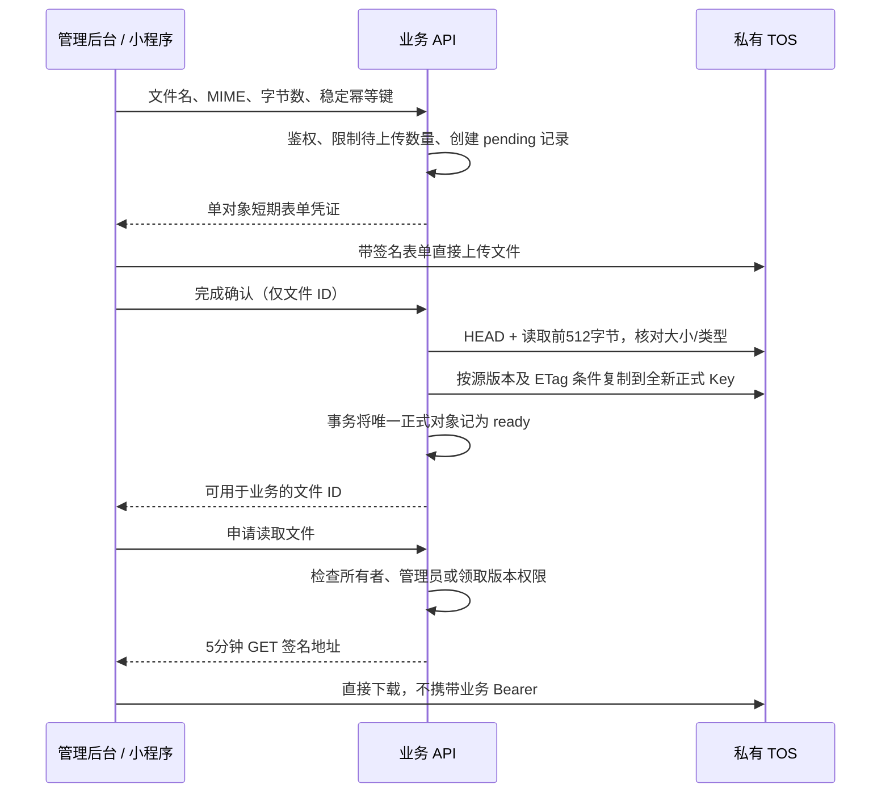

# 私有 TOS 与前端直传

管理后台和小程序直接将文件上传到火山 TOS。业务 API 只接收元数据、签发凭证及确认上传，不接收文件正文。

使用官方 Go SDK `github.com/volcengine/ve-tos-golang-sdk/v2`，固定版本 `v2.9.10`；签名使用 SDK 的 `PreSignedPostSignature` / `PreSignedURL`，不自行实现签名算法。

## 配置

在被 Git 忽略的 `.env` 填入：

```dotenv
TOS_BUCKET=
TOS_REGION=
TOS_ENDPOINT=
TOS_ACCESS_KEY=
TOS_SECRET_KEY=
TOS_OBJECT_PREFIX=btyx-v2/dev/
```

Endpoint 使用桶所属地域的 HTTPS 公网 Endpoint，例如北京地域 `https://tos-cn-beijing.volces.com`，不带 Bucket 名称。生产使用独立桶或独立前缀，例如 `btyx-v2/prod/`。当前使用 TOS 标准域名，不要求自定义域名。

空配置允许其他业务启动，上传/签名下载明确返回 503。部分填写但不完整会阻止启动，避免带着错误配置运行。AK/SK 不返回前端，不写入源码、日志、审计或示例文件。

桶和对象都必须保持私有。专用子账号仅授权项目桶/前缀内的读取、写入/复制和删除操作；如果开启版本控制，还需要对应版本的读、删权限。后端需要读取文件头、在桶内复制和清理并发产生的未引用副本，不需要管理桶或整个账号的权限。

## 协议



- `POST /api/v1/files/uploads`：JSON `{name,media_type,size}`，带 `Idempotency-Key`。返回 `{id,url,fields,expires_at,completed}`。
- `fields` 是完整表单参数。前端依次添加这些字段，再把 `file` 放到表单最后。小程序使用 `wx.uploadFile`，后台使用原生 `fetch` + `FormData`。
- 上传凭证有效期 10 分钟，限制为一个确切 Bucket/Key、私有 ACL、确切 MIME 及声明的文件字节数。仅支持 25MB 以内的 JPEG/PNG/GIF/WEBP/MP4；每用户最多 20 个未过期的待确认上传。
- `POST /api/v1/files/:id/complete`：只允许上传者调用。服务端以 HEAD 和文件前512字节检测核对，不相信前端“上传成功”的声明。文件头检测不是完整媒体解码或病毒扫描。
- 确认成功前，文件不能用于素材、任务版本或截图引用，也不能签发读取地址。
- `GET /api/v1/files/:id/download` 认证和权限检查后返回 `{storage,name,media_type,url,expires_at}`。管理后台使用文件类型和签名地址显示图片及视频预览。签名地址仅在内存使用，响应禁止缓存。

前端不使用业务 Axios 客户端向 TOS 上传，避免鉴权拦截器泄露业务 token。TOS 请求也不携带浏览器业务 Cookie。直传超时、响应丢失或重复上传冲突时，仍向后端尝试确认已有对象，确认成功才返回文件 ID。

## 身份证照片与识别

小程序用 Canvas 在身份证两面印上「仅供白兔严选实名认证使用」，将导出的 JPEG 直传私有 TOS。上传确认后，服务端为本人的已确认人像面生成两分钟的下载签名，并用腾讯云身份证 OCR 识别姓名和号码。应用日志及审计不写入证件原文或签名地址。

在服务端本地 `.env` 同时设置 `TENCENT_OCR_SECRET_ID` 和 `TENCENT_OCR_SECRET_KEY`。凭据需要授权身份证 OCR 和 FaceID `IdCardOCRVerification`。OCR 负责上传后填充姓名和身份证号。提交独立实名或未实名报名时，系统自动核验最终填写的姓名和身份证号。只有腾讯云返回结果码 `0` 才记录核验成功。未实名报名通过业务审核后，已核验的资料生效。缺少配置或核验服务暂不可用时返回 503。[腾讯云身份证 OCR](https://cloud.tencent.com/document/product/866/33524) · [身份证识别及信息核验](https://cloud.tencent.com/document/product/1007/37980)

实名认证记录按每次核验展示结果、失败原因和该次留存的资料。记录写入时保存脱敏姓名、脱敏证件号和已确认照片的文件引用，手机号脱敏、微信号加密保存。缺少当次资料的字段留空。获授「查看实名资料及证件照片」的运营账号可点击正反面缩略图查看大图。历史预览仅为该次记录引用的本人已确认私有 TOS 对象签发两分钟地址。证件更正后，历史记录仍引用更正前各自的照片。通用后台文件下载拒绝当前和历史的身份证照片。访问日志记录运营账号和记录条数，避免写入证件原文或签名地址。

## 不可覆盖的正式文件

临时对象在 `<prefix>uploads/`，正式对象在 `<prefix>objects/`。每次确认尝试使用一个新的正式 Key，并绑定 HEAD 得到的源版本及 ETag 复制。并发请求通过数据库事务只接受一个正式对象，其余副本按具体版本清理。

前端凭证只允许写临时 Key，即使被重放，也不能修改已确认的正式文件。这里不单独依赖 `forbid-overwrite`：TOS 的该参数在已开启/暂停版本控制的桶中不会阻止同名对象的新版本。正式文件另外保存 VersionID，下载签名绑定对应版本。

数据库事务不跨越 TOS 网络请求；数据库提交结果不确定时保留候选对象，避免误删已经被引用的文件。需要在后续维护中核对这类孤立正式对象。现有本地文件保留认证下载兼容，新上传不会退回本地存储。

## 桶端设置（拿到配置后联调）

1. 设置私有 ACL，确保 Bucket Policy 未授予匿名读写。
2. 浏览器直传需要在 TOS 桶配置实际后台的 Origin。本地后台默认使用 `http://127.0.0.1:8083`。允许 POST、GET、HEAD 和 Content-Type。生产按实际后台域名收窄，直传不发送 Cookie。
3. 为 `<prefix>uploads/` 配置短期生命周期清理，例如 1 天；已启用版本控制时同时考虑非当前版本。不要把该规则应用到 `objects/` 正式文件。
4. 小程序后台将实际桶域名加入 `uploadFile` 和 `downloadFile` 合法域名。开发者工具本机设置不代表发布环境已配置。
5. 真实联调核对：跨域、原生上传表单顺序、大小/类型限制、超时恢复、重复确认、私有匿名访问拒绝、下载过期、版本绑定及生命周期范围。

签名下载地址在有效期内可由持有者使用；撤回任务后无法再获取新地址，已签发地址仍可能在5分钟内有效。

官方参考：[Go SDK](https://github.com/volcengine/ve-tos-golang-sdk)、[PostObject](https://docs.volcengine.com/docs/torch-object-storage/post-object?lang=zh)、[预签名机制](https://docs.volcengine.com/docs/torch-object-storage/presigned-overview-go-sdk?lang=zh)。
